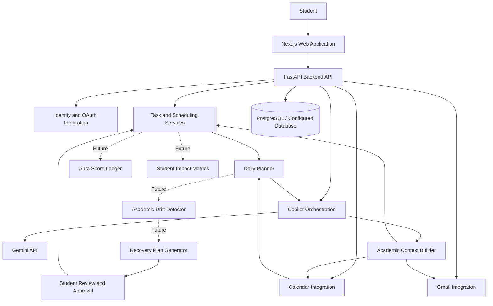

# Mentor AI — Your Personal AI Study Copilot

> **Mentor AI** is a student-focused AI copilot designed to help learners organize academic work, understand deadlines, plan their day, and manage study-related communication from one workspace.

**Team:** Code ArenaX  
**Project status:** Active development  
**Repository:** [Alfi-svg/Mentor-Ai](https://github.com/Alfi-svg/Mentor-Ai)  
**Frontend demo:** [https://frontend-ten-delta-a5irgspmf7.vercel.app](https://frontend-ten-delta-a5irgspmf7.vercel.app)  
**Backend API:** [https://mentor-ai-api-onzd.onrender.com](https://mentor-ai-api-onzd.onrender.com)  

> **Documentation note:** This README describes the intended product architecture and known project direction. Confirm the repository's current implementation, environment-variable names, model IDs, endpoints, and deployment configuration before treating any item as implemented. Features marked **Planned** or **Future Work** are proposals, not current capabilities.

---

## Table of Contents

- [Overview](#overview)
- [Problem Statement](#problem-statement)
- [Solution](#solution)
- [Key Features](#key-features)
- [Innovation: Academic Drift Detection and Recovery](#innovation-academic-drift-detection-and-recovery)
- [Future Work: Aura Score and Student Impact Score](#future-work-aura-score-and-student-impact-score)
- [System Architecture](#system-architecture)
- [Technology Stack](#technology-stack)
- [AI Methodology and Implementation](#ai-methodology-and-implementation)
- [AI Models and API Usage](#ai-models-and-api-usage)
- [Data Flow](#data-flow)
- [Security, Privacy, and Human Approval](#security-privacy-and-human-approval)
- [Installation and Setup](#installation-and-setup)
- [Environment Configuration](#environment-configuration)
- [Running Locally](#running-locally)
- [Testing](#testing)
- [Product Screenshots](#product-screenshots)
- [Team and Contributions](#team-and-contributions)
- [Roadmap](#roadmap)
- [Known Limitations](#known-limitations)
- [Contributing](#contributing)
- [License](#license)
- [Contact](#contact)

---

## Overview

Students often have to manage assignments, exams, deadlines, calendars, emails, and personal study plans across separate tools. Mentor AI aims to bring these activities into one student-oriented workspace and provide assistance that is useful beyond a standard question-and-answer chatbot.

The long-term vision is a **proactive academic copilot** that can help students:

1. Understand what needs attention.
2. Prioritize tasks using deadlines and available time.
3. Organize academic responsibilities.
4. Review relevant email information and draft replies.
5. Detect when a plan is becoming unrealistic and suggest a recovery plan.
6. Reflect on progress and build consistent study habits.

Mentor AI is intended to support student decisions, not make consequential decisions without the student's knowledge or approval.

## Problem Statement

Students can struggle to manage academic responsibilities because:

- Tasks, deadlines, calendars, and email are often separated.
- A task list shows what remains to be done but may not explain what should be done first.
- A missed task can disrupt the rest of a student's plan.
- Students may notice schedule conflicts only when a deadline is close.
- Repeatedly organizing a schedule takes time away from learning.
- Students need practical guidance that considers deadlines and available time, rather than generic motivation.

## Solution

Mentor AI combines an AI copilot with task management and planning workflows. Its intended approach is to connect a student's academic context, identify the next useful action, explain recommendations, and let the student review proposed changes.

The product direction focuses on three principles:

- **Context-aware assistance:** recommendations should use relevant tasks, deadlines, and schedule information available to the system.
- **Actionable planning:** suggestions should lead to a clear next step, not just a conversational answer.
- **Student control:** the student should be able to review, edit, approve, or reject important proposed actions.

## Key Features

The list below reflects the project's known product direction. Verify each item against the current deployed build before describing it as fully implemented.

- **AI Copilot:** Ask questions and get help with academic tasks and planning through text or voice, depending on the enabled interface.
- **Task Management:** Create and manage tasks with deadlines, priorities, and completion status.
- **Calendar and Scheduling:** View academic events and plan around deadlines; Google Calendar integration is part of the project direction.
- **AI Day Planner:** Help organize the day and suggest a useful task sequence.
- **Gmail Assistance:** Explore relevant email information, summarize messages, identify action items, and prepare reply drafts where integration is enabled.
- **Reminders and Deadline Awareness:** Surface upcoming tasks and scheduling concerns where notification functionality is configured.
- **Approval-oriented Actions:** Keep the student in control of important actions, such as sending a drafted email or applying a proposed plan.

---

## Innovation: Academic Drift Detection and Recovery

**Status: Proposed / Future Work unless already implemented in the current branch.**

Academic Drift Detection aims to identify when a student's actual progress diverges from their planned progress. Instead of only showing a missed-task reminder, Mentor AI would explain the impact and propose a realistic recovery plan.

### Example

A student has an assignment due tomorrow and an exam soon after. The assignment is estimated to require three hours, but only two hours are available in the current schedule. Mentor AI could flag the conflict, explain the assumptions, and offer a revised plan for the student to review.

### Proposed workflow

1. **Observe:** Read relevant tasks, deadlines, completion states, estimates, and calendar availability.
2. **Compare:** Compare planned progress with actual progress.
3. **Detect drift:** Identify overdue or at-risk work and schedule conflicts.
4. **Estimate risk:** Use transparent rules and available data to classify risk; do not present uncertain predictions as facts.
5. **Generate recovery options:** Suggest a revised sequence or time blocks and explain trade-offs.
6. **Request approval:** Let the student review and edit the plan before changes are applied.
7. **Track outcome:** Check whether the revised plan helped the student complete the intended work.

### Initial implementation approach

A first version can use deterministic rules for deadline and time-budget calculations, with the existing AI service used to explain the results in natural language.

Example signals:

- Task due date and remaining time.
- Estimated task duration, if supplied.
- Available calendar time.
- Task completion state.
- Number and urgency of competing tasks.

Do not calculate a reliable risk score if required inputs are missing. Show missing assumptions and let the student correct them.

---

## Future Work: Aura Score and Student Impact Score

**Status: Future Work — not a claim about the current product.**

Mentor AI may introduce a student-facing progress system that rewards consistent action without turning learning into a competition.

### Aura Score

The proposed **Aura Score** is a positive progress/reward score. For example, a student could earn **10+ Aura points** after completing an eligible task. The final point values, eligibility rules, and anti-abuse controls need to be designed and tested before implementation.

Potential design rules:

- Award points only after a task is genuinely marked complete.
- Define whether points depend on task type, effort, or verified completion.
- Prevent repeated toggling between complete and incomplete from farming points.
- Keep a transaction/history log for point awards and corrections.
- Make scoring rules visible and understandable to students.
- Avoid penalizing students for disability, illness, personal circumstances, or tasks that were estimated incorrectly.
- Do not present Aura as a measure of a student's intelligence, worth, or guaranteed academic performance.

### Student Impact Score / Quality Score

A separate **Student Impact Score** could summarize progress across selected, explainable indicators, such as:

- Task completion consistency.
- Meeting planned deadlines.
- Recovery after a disrupted plan.
- Study-plan follow-through.
- Optional self-reported learning reflections or quiz outcomes, if added later.

This score should not be presented as an objective measure of student quality. It should be framed as a private, supportive progress indicator, with transparent components and a way to correct inaccurate data.

### Suggested distinction

- **Aura Score:** a gamified reward balance for eligible completed actions.
- **Student Impact Score:** a broader, explainable reflection of progress over time.

These should remain separate so that points earned do not automatically imply learning mastery. A student can complete a task without fully understanding the material.

---

## System Architecture

The following is a **conceptual architecture** for the product. Adjust it to match the actual modules and services in the repository.



### Architecture responsibilities

| Layer | Responsibility |
| --- | --- |
| Web client | Student-facing dashboard, Copilot interface, tasks, calendar, planner, and settings |
| FastAPI backend | API endpoints, validation, business logic, and orchestration |
| Copilot orchestration | Build context, invoke the configured AI model, and return structured assistance |
| Task and scheduling services | Manage tasks, deadlines, status, and planning rules |
| Google integrations | Access authorized calendar and email data where configured |
| Database | Persist application data and integration metadata |
| Drift/recovery module | **Future:** compare planned and actual progress and propose recovery options |
| Aura/Impact module | **Future:** track transparent reward events and progress indicators |

## Repository Structure

The repository is organized into a Next.js frontend, a versioned FastAPI backend, AI and scheduling services, tests, infrastructure scripts, and engineering documentation.

```text
mentor-ai/
├── backend/                         # FastAPI Application (Python 3.12+)
│   ├── alembic/                     # Database version migrations
│   │   ├── versions/                # 001_initial_schema.py, 002_row_level_security.py
│   │   └── env.py                   # Async migration runner (PostgreSQL + SQLite)
│   ├── app/
│   │   ├── api/v1/                  # Versioned API routes & endpoints
│   │   │   ├── endpoints/actions.py # Two-phase human approvals, confirm & verify
│   │   │   ├── endpoints/auth.py    # Signup, login, logout, me, preferences
│   │   │   ├── endpoints/chat.py    # Natural language chat assistant endpoint
│   │   │   ├── endpoints/health.py  # Truthful liveness & readiness probes
│   │   │   ├── endpoints/planner.py # Draft plan generation & explicit confirmation
│   │   │   ├── endpoints/schedule.py # Deterministic schedule generation & approval
│   │   │   ├── endpoints/tasks.py   # Task CRUD, filters, actions & archiving
│   │   │   └── router.py            # Aggregated v1 router
│   │   ├── core/
│   │   │   ├── config.py            # Pydantic Settings & safe CORS validation
│   │   │   ├── errors.py            # Consistent error response envelopes
│   │   │   ├── logging.py           # Structured logging foundation
│   │   │   └── security.py          # JWT claims validation & FastAPI auth dependencies
│   │   ├── db/
│   │   │   ├── base.py              # DeclarativeBase metadata
│   │   │   ├── session.py           # Async engine, sessionmaker & fallback provider
│   │   │   └── models/              # Profile, UserPreferences, Task, Schedule, Block, etc.
│   │   ├── schemas/                 # Pydantic v2 schemas
│   │   │   ├── action.py            # ActionResponse, Confirm & Verify schemas
│   │   │   ├── planner.py           # DraftPlan, PlanProposal, Confirm schemas
│   │   │   └── task.py              # TaskCreate, TaskUpdate, TaskResponse schemas
│   │   ├── services/
│   │   │   ├── action_service.py    # Staged actions, approvals & idempotency cache
│   │   │   ├── ai/                  # Provider-agnostic AI adapters (Gemini, Groq, Offline)
│   │   │   │   ├── base.py          # BaseLLMAdapter interface
│   │   │   │   ├── factory.py       # Resilient fallback orchestration
│   │   │   │   ├── gemini.py        # Google Gemini 1.5/2.0 Flash HTTP adapter
│   │   │   │   ├── groq.py          # Groq Llama 3.3 70B HTTP adapter
│   │   │   │   ├── models.py        # Context & parse result models
│   │   │   │   ├── offline.py       # Deterministic rule & heuristic parser
│   │   │   │   └── sanitizer.py     # Prompt injection defense & JSON auto-repair
│   │   │   ├── auth/                # Supabase GoTrue Auth service adapter
│   │   │   ├── mcp/                 # Official Python MCP SDK server implementation
│   │   │   │   └── server.py        # 8 typed tools, MCPServer instance & auth middleware
│   │   │   ├── planner_service.py   # Draft generation, clarification & preview engine
│   │   │   ├── scheduler/           # Pure deterministic interval engine & validator
│   │   │   └── task_service.py      # Task domain service, state transitions & audit trail
│   │   └── main.py                  # FastAPI application entrypoint & middleware
│   ├── mcp_server.py                # Standalone CLI runner for stdio and remote SSE MCP
│   ├── alembic.ini                  # Alembic CLI configuration
│   ├── pyproject.toml               # Tool configs (Ruff, Pytest, Mypy)
│   ├── requirements.txt             # Pinned production dependencies (mcp>=2.3.0)
│   ├── requirements-dev.txt         # Dev, testing, and linting dependencies
│   └── .env.example                 # Backend configuration placeholders
├── frontend/                        # Next.js 15 Web Application (TypeScript)
│   ├── app/
│   │   ├── layout.tsx               # Root layout & accessibility metadata
│   │   ├── page.tsx                 # Landing page & system architecture overview
│   │   ├── team/                    # Dedicated Developer Team page (Code ArenaX)
│   │   └── globals.css              # Tailwind base styling
│   ├── components/                  # Reusable UI components
│   │   ├── AppShell.tsx             # Responsive shell, navigation & footer credit
│   │   ├── HealthStatusBadge.tsx    # Live backend health probe indicator
│   │   └── MentorLogo.tsx           # Scalable brand vector mark & wordmark
│   ├── lib/api.ts                   # Type-safe backend API fetch client
│   ├── lib/team-data.ts             # Centralized developer team metadata
│   ├── public/                      # Static assets & team avatars
│   ├── package.json                 # Pinned dependencies & scripts
│   ├── tsconfig.json                # Strict TypeScript configuration
│   └── .env.example                 # Frontend client configuration
├── tests/                           # Multi-tier test suite
│   └── backend/                     # Pytest suite
│       ├── conftest.py              # TestClient fixtures, JWT tokens & isolated DB
│       ├── test_actions.py          # Action staging, approval workflow & idempotency
│       ├── test_ai_adapters.py      # Offline parser, Gemini/Groq mocks, timeouts & injection
│       ├── test_auth.py             # Signup, login, logout, token validation & expired claims
│       ├── test_cors.py             # Safe CORS origin validation tests
│       ├── test_data_isolation.py   # Multi-tenant data isolation & ownership verification
│       ├── test_errors.py           # Standardized error envelope tests
│       ├── test_health.py           # Truthful liveness & readiness probe assertions
│       ├── test_mcp_tools.py        # Protocol unit & integration tests for 8 MCP tools
│       ├── test_migrations.py       # Alembic migration upgrade & downgrade reversibility
│       ├── test_planner.py          # Draft plan generation, preview schedule & confirmation
│       ├── test_scheduler.py        # Deterministic solver, validator, intervals & persistence
│       └── test_tasks.py            # Task CRUD, filters, state transitions & validation
├── infra/                           # Operational scripts
│   ├── local-dev.sh                 # Unified / standalone development runner
│   └── README.md                    # Deployment runbook & zero-budget topology
├── docs/                            # Approved engineering specifications
│   ├── PRD.md                       # Product Requirements Document
│   ├── ARCHITECTURE.md              # System Architecture & Component Deep-Dive
│   ├── DATABASE_DESIGN.md           # Database ER Diagram, Schema DDL & RLS Policies
│   ├── API_CONTRACT.md              # OpenAPI 3.1 Contract & Endpoint Specifications
│   ├── AI_AND_SCHEDULER.md          # Deterministic Scheduler & NLU Pipeline
│   ├── MCP_SPEC.md                  # MCP Server Specification (8 Typed Tools)
│   ├── THREAT_MODEL.md              # STRIDE Security Model & Defense-in-Depth
│   ├── DEPLOYMENT_PLAN.md           # Zero-Budget Free-Tier Matrix & Topology
│   ├── 12_DAY_PLAN.md               # 12-Day Implementation Roadmap
│   └── ACCEPTANCE_CRITERIA.md       # Master Acceptance Criteria & Verification Matrix
├── .github/
│   └── workflows/
│       └── ci.yml                   # GitHub Actions CI: lint, type-check & build
├── .gitignore                       # Ignore rules for dependencies, build artifacts, secrets
└── README.md                        # Main project documentation
```

> **Keep this tree synchronized with the repository.** It documents the structure supplied by the project team; verify file paths, test counts, model versions, and implementation status against the current branch before publishing claims that may change.

## Technology Stack

Based on the project's previously described stack; verify exact versions and dependencies in the current repository.

| Area | Technology / Service |
| --- | --- |
| Frontend | Next.js, React, TypeScript |
| Styling | Tailwind CSS |
| Backend | Python, FastAPI |
| Data layer | SQLAlchemy (async usage has been part of the project) |
| Database | PostgreSQL in deployment-oriented setup; local configuration may differ |
| Schema migrations | Alembic |
| AI integration | Google Gemini API |
| Calendar | Google Calendar API / OAuth, where configured |
| Email | Gmail API / OAuth, where configured |
| Deployment | Vercel frontend and Render backend, as previously configured |
| Testing | Project-configured backend and frontend test tools |

Exact versions should be taken from `package.json`, the Python dependency file, and deployment configuration rather than guessed here.

## AI Methodology and Implementation

Mentor AI's intended AI workflow can be described as follows:

1. **Request interpretation:** Identify whether the student is asking for information, a task recommendation, planning help, or an integration-backed action.
2. **Context retrieval:** Retrieve only the task, schedule, or email information needed for the request and permitted by the student's authorization.
3. **Deterministic computation:** Calculate date differences, time budgets, ordering constraints, and deadline conflicts in backend logic.
4. **AI generation:** Use the configured Gemini model for natural-language reasoning, explanations, and response generation where appropriate.
5. **Action validation:** Validate any proposed action against application rules and the user's permissions.
6. **Human review:** Require confirmation for consequential operations, such as sending an email or applying a proposed plan, according to the application's configured workflow.
7. **Persistence and feedback:** Save approved changes and use recorded outcomes to improve planning logic where supported.

### Important implementation principle

Do not rely on a language model alone for exact date arithmetic, deadline calculations, point balances, or permission checks. Use validated backend logic for those operations and let the model explain the resulting facts.

## AI Models and API Usage

### Google Gemini

The project has used the **Google Gemini API** as its AI integration. The exact model ID may change by environment and must be confirmed from the current code/configuration.

Expected use cases may include:

- Copilot response generation.
- Summarization and task extraction.
- Planning explanations.
- Voice transcription, only if the current implementation explicitly uses a Gemini model for that purpose.

**Before publishing:** replace this section with the exact model ID(s) actually called by the application, their purpose, and the relevant source module. Do not claim a model or capability that is not in the code.

### Google Calendar API

Where enabled, the integration can read or synchronize calendar events after the user grants the required OAuth permissions. List the actual scopes and supported operations after checking the implementation.

### Gmail API

Where enabled, the integration can access authorized email data and support summaries or reply drafts. Sending an email should remain subject to the application's confirmation flow and granted OAuth scopes.

### API key handling

- Store secret keys in backend environment variables or a secrets manager.
- Never expose private API keys in frontend code or commit them to Git.
- Use OAuth securely and request only the scopes required.
- Configure API quotas and error handling.
- Do not include real user email content, tokens, or secrets in logs or screenshots.

---

## Data Flow

### Copilot request

1. Student submits a text or voice request.
2. The frontend sends the request to the backend.
3. The backend validates the request and obtains authorized context.
4. Deterministic services calculate exact task or schedule facts as needed.
5. The AI model generates an explanation or recommendation.
6. The backend validates the response and any proposed action.
7. The frontend displays the result and requests approval when necessary.

### Future Academic Drift workflow

1. Load planned tasks and current completion states.
2. Compare remaining work with deadlines and available time.
3. Flag possible conflicts and explain the data behind the flag.
4. Generate one or more recovery options.
5. Let the student approve or edit the selected option.
6. Apply approved changes and track the outcome.

## Security, Privacy, and Human Approval

Mentor AI may handle sensitive academic schedules and personal email. The implementation should follow these principles:

- Use authentication and authorization appropriate to the deployed application.
- Keep API keys and OAuth client secrets on the server.
- Validate and sanitize incoming data.
- Request minimal Google OAuth scopes.
- Protect tokens at rest and in transit.
- Avoid logging email bodies, credentials, or unnecessary personal data.
- Provide a way to disconnect integrations and revoke access.
- Require student confirmation before sending drafted emails or applying meaningful schedule changes.
- Keep AI recommendations explainable and allow users to edit or reject them.
- Do not describe predictions as guaranteed outcomes.

## Installation and Setup

These are general setup steps. Confirm the exact commands and file paths against the repository's current README, package files, and backend dependency configuration.

### Prerequisites

- Git
- A supported Node.js version
- Python version supported by the backend dependency configuration
- A configured database, if required for local development
- A Google Gemini API key for AI features
- Google OAuth credentials for Calendar/Gmail integration, if testing those features

### 1. Clone the repository

```bash
git clone https://github.com/Alfi-svg/Mentor-Ai.git
cd Mentor-Ai
```

### 2. Inspect the project structure

Identify the frontend and backend directories and follow their own dependency files:

```text
Mentor-Ai/
├── frontend/
├── backend/
├── README.md
└── ...
```

### 3. Install frontend dependencies

Run from the actual frontend directory containing `package.json`:

```bash
npm install
```

### 4. Install backend dependencies

Run from the actual backend directory. If the project uses a `requirements.txt` file:

```bash
python -m venv .venv
```

Activate the environment:

**macOS / Linux**

```bash
source .venv/bin/activate
```

**Windows PowerShell**

```powershell
.venv\Scripts\Activate.ps1
```

Then install dependencies if `requirements.txt` is present:

```bash
python -m pip install -r requirements.txt
```

If the project uses `pyproject.toml` or another package manager, use the repository's documented installation method instead.

### 5. Configure environment variables

Create local environment files using the project's example files, if available. Use the actual variable names defined by the source code. See [Environment Configuration](#environment-configuration).

### 6. Configure the database and migrations

If Alembic migrations are configured, apply them using the backend's documented workflow. For a typical Alembic setup:

```bash
alembic upgrade head
```

Run this from the directory containing the correct Alembic configuration and environment. Confirm the database URL before running migrations.

## Environment Configuration

Environment variable names are intentionally not invented in this template. Inspect the code and any `.env.example` files to determine the exact names.

Typical categories include:

| Category | Purpose |
| --- | --- |
| Gemini API key | Server-side access to the configured AI model |
| Database URL | Connection to the configured database |
| Google OAuth client ID | Identifies the OAuth application |
| Google OAuth client secret | Server-side OAuth secret; never commit it |
| OAuth redirect URI | Callback URL registered with Google |
| Session/token encryption secret | Protects session or token-related data, if used |
| Frontend API base URL | Points the frontend to the backend API |
| CORS allowed origins | Controls which frontend origins can call the backend |

Use placeholder values in documentation, never production secrets. Keep `.env` files out of version control and commit a sanitized `.env.example` instead.

## Running Locally

Start the backend and frontend using the commands defined by the project.

### Backend

For a typical FastAPI application, if the entry point is `main.py` and the ASGI object is `app`, a common command is:

```bash
uvicorn main:app --reload
```

Run it from the directory where the module is importable. Adjust the module path and configuration to match the repository.

### Frontend

From the directory containing the frontend `package.json`:

```bash
npm run dev
```

Open the local URL printed by the development server. Confirm the frontend API base URL points to the local backend.

## Testing

Before a release, test at least:

- Copilot text requests and error states.
- Voice input/output if enabled.
- Task creation, editing, completion, and deadlines.
- Calendar views and Google Calendar sync if configured.
- Gmail access, summaries, reply drafts, and send confirmation if configured.
- AI Planner generation and approval flow.
- OAuth failure, expired credentials, API quota errors, and offline backend behavior.
- Responsive layouts and accessibility.
- Authorization boundaries and protection of private data.

Use the repository's actual test commands. Do not report test counts or passing status in this README unless they have been run against the current commit.

## Product Screenshots

Add real, current screenshots here. Save sanitized images in a repository folder such as `docs/screenshots/` and update the paths to match the committed filenames.

### Dashboard


### AI Copilot


### Tasks and Scheduling


### Gmail and AI Planner


### Developer Team


> If a screenshot is not yet available, remove its image entry or add the real image at the indicated path. Do not commit private emails, OAuth tokens, API keys, or personal student data.

## Team and Contributions

**Team: Code ArenaX**

The roles below summarize the known project contributions:

### Alfi Shahrin Talukder
- **Role:** Full-Stack & AI Systems Engineer
- **GitHub:** [https://github.com/Alfi-svg](https://github.com/Alfi-svg)
- **LinkedIn:** [https://www.linkedin.com/in/alfi-shahrin-talukder-a68450370/](https://www.linkedin.com/in/alfi-shahrin-talukder-a68450370/?isSelfProfile=true)
- **Contributions:**
  - AI Copilot and Gemini multimodal orchestration pipeline.
  - Proactive Daily Briefing engine and planning workflow.
  - Full-stack security, token encryption, and architectural foundation.

### Samiul Islam
- **Role:** Software & Systems Engineer
- **GitHub:** [https://github.com/samiulxr2](https://github.com/samiulxr2)
- **LinkedIn:** [https://www.linkedin.com/in/samiulxr2/](https://www.linkedin.com/in/samiulxr2/)
- **Contributions:**
  - Google Calendar 2-way synchronization and scheduling workflow.
  - Task management logic and deterministic scheduler integration.
  - Frontend design system, responsive UI components, and AppShell layout.

## Roadmap

### Current product direction

- Continue improving Copilot reliability and contextual recommendations.
- Strengthen task, calendar, and planner workflows.
- Improve integration error handling and user experience.
- Keep important actions reviewable and under student control.

### Future Work

- [ ] **Academic Drift Detector:** identify divergence between planned and actual progress.
- [ ] **Recovery Plan Engine:** propose realistic alternatives when deadlines or schedules conflict.
- [ ] **What-If Planner:** preview the impact of changing a task or time commitment.
- [ ] **Aura Score:** award points for eligible completed tasks, with transparent rules and anti-abuse protection.
- [ ] **Student Impact Score:** provide an explainable private progress indicator rather than a judgment of student worth.
- [ ] **Learning Evidence Loop:** optionally use quizzes or retrieval practice to help students check understanding.
- [ ] **Progress History:** show how plans and completion patterns change over time.

## Known Limitations

- AI recommendations depend on the accuracy and completeness of available task, deadline, and calendar data.
- Google integration capabilities depend on OAuth configuration, permissions, quotas, and API availability.
- Exact AI model names and enabled capabilities can vary by deployment configuration.
- Academic Drift Detection, Aura Score, Student Impact Score, and related roadmap items are proposed future features unless the current code proves otherwise.
- Mentor AI is a productivity aid, not a guarantee of academic success or a substitute for a student's judgment.

## Contributing

Contributions should preserve student privacy, validate backend operations, and include tests for new behavior.

Suggested workflow:

1. Create a feature branch.
2. Make a focused change.
3. Add or update tests.
4. Run the relevant checks locally.
5. Open a pull request describing the change, its impact, and any configuration requirements.

For new AI capabilities, document the model/API used, the data sent to it, failure behavior, and whether human approval is required.

## License

Add the project's chosen open-source license before publishing. Until a license is included in the repository, reuse and redistribution permissions may be limited.

## Contact

- **Project:** Mentor AI
- **Team:** Code ArenaX
- **Repository:** [https://github.com/Alfi-svg/Mentor-Ai](https://github.com/Alfi-svg/Mentor-Ai)
- **Frontend demo:** [https://frontend-ten-delta-a5irgspmf7.vercel.app](https://frontend-ten-delta-a5irgspmf7.vercel.app)
- **Backend API:** [https://mentor-ai-api-onzd.onrender.com](https://mentor-ai-api-onzd.onrender.com)

---

<p align="center">
  <strong>Mentor AI — Your Learning. Your Goals. Your Copilot.</strong><br>
  Built with care by Code ArenaX
</p>
