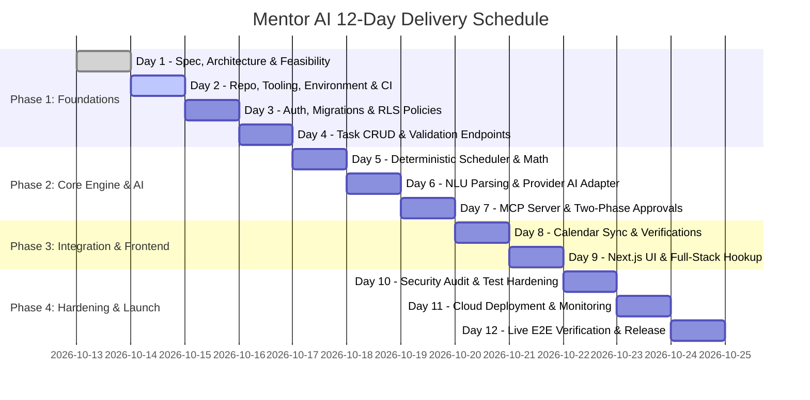

# 12-Day Implementation Roadmap — Mentor AI

**Budget:** $0.00 USD  
**Methodology:** Incremental Vertical Slices, Test-Driven Development, Continuous Verification  

---

## Roadmap Overview

---

## Daily Milestones & Acceptance Criteria

### Day 1: Architecture, Planning & System Design
- **Deliverables:** Complete PRD, system architecture, database schema, API contracts, AI/scheduler specs, MCP specifications, threat model, zero-budget feasibility study, 12-day plan, acceptance checklist.
- **Acceptance Criteria:**
  - All 10 architectural specification documents completed and reviewed.
  - Zero-budget feasibility verified for all third-party services.
  - Human review and approval obtained before coding begins.

### Day 2: Repository Scaffolding, Environment & Tooling
- **Deliverables:** Monorepo structure (`apps/web` + `apps/api`), Python virtualenv with `pyproject.toml` / `requirements.txt`, Next.js 15 App Router setup, Ruff linter/formatter, ESLint, Prettier, `.env.example`, GitHub Actions CI pipeline.
- **Acceptance Criteria:**
  - `apps/api` starts cleanly with uvicorn and passes Ruff formatting and linting.
  - `apps/web` builds without TypeScript or ESLint errors (`pnpm build` or `npm run build`).
  - Automated CI workflow runs lint and type-checking on both applications.

### Day 3: Authentication, Database Migrations & Row-Level Security
- **Deliverables:** Supabase project configuration, SQLAlchemy 2.0 async database models, Alembic baseline migrations, Supabase JWT verification middleware, RLS policies enabled on all tables.
- **Acceptance Criteria:**
  - Alembic runs `upgrade head` successfully against PostgreSQL.
  - Supabase JWT token successfully authenticates and injects current user identity.
  - Requests with invalid or missing tokens return HTTP 401.
  - RLS verification test proves User A cannot read or mutate User B's rows.

### Day 4: Task Management CRUD & API Validation
- **Deliverables:** Complete `/api/v1/tasks` endpoints (Create, Read, Update, Delete, Filter), Pydantic v2 domain schemas, automated Pytest test suite for task lifecycle.
- **Acceptance Criteria:**
  - User can create tasks with valid priority (`P1`-`P4`) and duration (1-720 min).
  - Invalid inputs (negative duration, empty title) return HTTP 422 with structured error details.
  - Status updates (`pending` -> `in_progress` -> `completed`) are persisted and timestamped.
  - 100% of task CRUD tests pass.

### Day 5: Deterministic Scheduling Engine & Conflict Validation
- **Deliverables:** Pure Python interval algebra scheduling engine in `services/scheduler/`, priority queue sorter, fixed commitment masking, buffer insertion, break injection, conflict detector, comprehensive Pytest unit tests.
- **Acceptance Criteria:**
  - Scheduler places tasks strictly within configured user working hours.
  - Hard calendar commitments are never overlapped or truncated.
  - 15-minute buffers are respected adjacent to meetings.
  - If tasks exceed available time, scheduler returns status `conflict_detected` with exact unscheduled task breakdown.
  - 100% test coverage on interval mathematics edge cases; solver executes in $< 100\text{ms}$.

### Day 6: Natural Language Parsing & Provider AI Adapter
- **Deliverables:** `services/ai/` module, `BaseLLMAdapter` interface with Google Gemini 1.5/2.5 Flash implementation, Groq fallback, and `DeterministicOfflineAdapter` for 100% offline testing. Pydantic v2 `DraftPlan` structured output validator and clarification question generator.
- **Acceptance Criteria:**
  - Prompt *"Plan my day tomorrow with 2 lectures and 2 hours for homework"* extracts structured `DraftPlan`.
  - Prompts missing task duration trigger a structured clarification question rather than an arbitrary hallucination.
  - Offline parser passes all test suites with 0 API keys and zero internet access.
  - Rate limits (HTTP 429) trigger automatic retries with exponential backoff.

### Day 7: Model Context Protocol (MCP) Server & Two-Phase Approvals
- **Deliverables:** FastMCP server in `app/mcp/` exposing 8 typed tools (`get_user_context`, `list_tasks`, `create_task`, `update_task`, `get_calendar_events`, `create_calendar_event`, `generate_schedule`, `verify_action`). Two-phase approval manager with `idempotency_key` deduplication.
- **Acceptance Criteria:**
  - MCP tools conform to JSON Schema and are discoverable via MCP stdio/SSE transports.
  - Consequential mutations stage in `action_history` with status `pending_approval`.
  - Duplicate requests with identical `idempotency_key` return cached results without re-executing.
  - Action execution verifies post-condition state and logs verification evidence.

### Day 8: Real Calendar Integration & Verification Adapters
- **Deliverables:** Google Calendar API v3 OAuth 2.0 adapter (Testing Mode) and universal read-only iCal (.ics) parser in `services/calendar/`. Bi-directional event synchronization and state verification.
- **Acceptance Criteria:**
  - Real Google Calendar events sync into `calendar_events` table as fixed commitments.
  - Approved external event creations generate real Google Calendar events with verified IDs.
  - Invalid or expired OAuth tokens fail gracefully with clear re-authorization prompts.
  - iCal feed parser correctly parses `.ics` files/URLs without external paid dependencies.

### Day 9: Next.js Frontend & Full-Stack Integration
- **Deliverables:** Next.js 15 user interface: Dashboard overview, interactive daily schedule timeline, task board, natural language chat bar with optional Web Speech API voice input, action approval modal, error toasts.
- **Acceptance Criteria:**
  - End-to-end user journey works: user enters prompt -> schedule preview renders -> user approves -> timeline displays blocks.
  - Pending approval banner displays clear diff of proposed changes.
  - Interface is fully responsive on desktop and mobile viewports.
  - Keyboard navigation and WCAG 2.1 AA color contrast compliance verified.

### Day 10: Security Review, Automated Testing & Bug Fixes
- **Deliverables:** End-to-end integration tests, security test suite (IDOR checks, prompt injection resilience, JWT tampering, SQL injection checks), critical bug fixes, accessibility audit.
- **Acceptance Criteria:**
  - Automated test suite passes (Unit, API, Scheduler, MCP, Security).
  - No cross-tenant data leaks possible under adversarial testing.
  - Zero secrets or API keys exposed in browser source maps or client-side bundles.

### Day 11: Production Deployment, Environment Setup & Health Monitoring
- **Deliverables:** Deployment to Vercel (Next.js) and Render/container (FastAPI), Supabase production database migration, production environment variables injected, `/api/v1/health` and `/api/v1/health/ready` probes verified, SSL validation.
- **Acceptance Criteria:**
  - Live frontend accessible over HTTPS with zero console errors.
  - Backend API responds with HTTP 200 on health probes.
  - Database migrations applied to production Supabase database.
  - Cold-start handling verified with user-friendly loading state.

### Day 12: Live Verification, Documentation & Release Sign-Off
- **Deliverables:** Live production end-to-end smoke test, comprehensive user guide, disaster recovery runbook, backup procedures, known limitations documentation, final release sign-off.
- **Acceptance Criteria:**
  - A new user can sign up, create tasks, submit natural language prompts, generate conflict-free schedules, and approve calendar syncs on live production.
  - All documentation is complete and truthful.
  - Final project demo recorded or verified.
