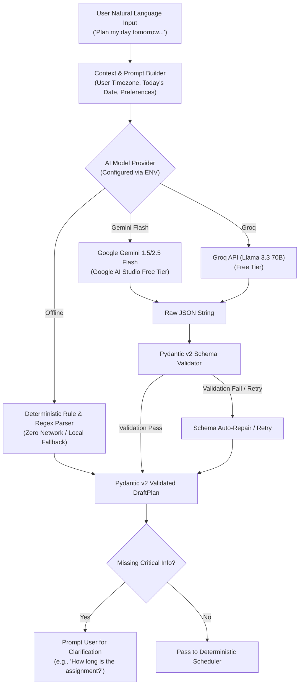

# AI Planning Pipeline & Deterministic Scheduler Engine — Mentor AI

**Architecture Principle:** Separate non-deterministic language understanding from deterministic scheduling execution. The AI never resolves mathematical time conflicts; the Python scheduler is the sole authority.

---

## 1. AI Planning Pipeline



---

## 2. Structured Output JSON Schema (DraftPlan)

The NLU service forces the LLM to output strictly against the following JSON schema:

```json
{
  "$schema": "https://json-schema.org/draft/2020-12/schema",
  "title": "DraftPlan",
  "type": "object",
  "properties": {
    "intent": {
      "type": "string",
      "enum": ["plan_day", "add_task", "add_event", "reschedule", "clarification_needed", "general_query"]
    },
    "target_date": {
      "type": "string",
      "format": "date",
      "description": "ISO date YYYY-MM-DD for the target schedule"
    },
    "explanation": {
      "type": "string",
      "description": "Brief, user-facing summary of understanding"
    },
    "fixed_events": {
      "type": "array",
      "items": {
        "type": "object",
        "properties": {
          "title": {"type": "string"},
          "start_time": {"type": "string", "format": "date-time"},
          "end_time": {"type": "string", "format": "date-time"},
          "location": {"type": ["string", "null"]}
        },
        "required": ["title", "start_time", "end_time"]
      }
    },
    "tasks": {
      "type": "array",
      "items": {
        "type": "object",
        "properties": {
          "title": {"type": "string"},
          "duration_minutes": {"type": "integer", "minimum": 1, "maximum": 720},
          "priority": {"type": "string", "enum": ["P1", "P2", "P3", "P4"]},
          "deadline": {"type": ["string", "null"], "format": "date-time"},
          "energy_level": {"type": "string", "enum": ["high", "medium", "low"]}
        },
        "required": ["title", "duration_minutes"]
      }
    },
    "clarification_question": {
      "type": ["string", "null"],
      "description": "Question asked if user input is missing required duration or date"
    }
  },
  "required": ["intent", "target_date", "explanation", "fixed_events", "tasks"]
}
```

---

## 3. The Deterministic Scheduling Algorithm

### 3.1 Mathematical Formulation
Let the scheduling day be defined by user working interval:
$$W = [T_{\text{start}}, T_{\text{end}}]$$
where $T_{\text{start}}$ and $T_{\text{end}}$ are minutes from midnight in the user's local timezone.

#### Step 1: Fixed Event Masking & Buffer Expansion
Given a set of $M$ fixed calendar events $E = \{e_1, e_2, \dots, e_M\}$, where each $e_i = [s_i, f_i]$ with $s_i < f_i$.
For a configured user buffer $B \ge 0$ minutes:
$$e_i^{\text{buffered}} = [\max(T_{\text{start}}, s_i - B), \min(T_{\text{end}}, f_i + B)]$$
Merge all overlapping or contiguous buffered intervals into disjoint occupied intervals:
$$O = \text{MergeOverlaps}(\{e_i^{\text{buffered}}\})$$

#### Step 2: Available Free Interval Computation
The available free interval set $F$ is the set difference between working interval $W$ and occupied intervals $O$:
$$F = W \setminus O = \{[u_1, v_1], [u_2, v_2], \dots, [u_K, v_K]\}$$
where each $[u_k, v_k]$ represents contiguous free minutes, sorted chronologically with $u_k < v_k$.

#### Step 3: Priority & Urgency Sorting
Given $N$ tasks to be scheduled, sort tasks by a deterministic multi-key comparator:
1. **Priority Rank:** $P1 = 1, P2 = 2, P3 = 3, P4 = 4$ (ascending).
2. **Deadline Urgency:** Earliest deadline first ($d_i$ ascending; null deadlines placed last).
3. **Duration (Longest Processing Time First):** $L_i$ descending to optimize contiguous block utilization.

$$\text{SortKey}(t_i) = (\text{PriorityRank}(t_i), \text{DeadlineOrMax}(t_i), -L_i)$$

#### Step 4: Interval Allocation (First-Fit with Break Injection)
For each sorted task $t_i$ with required duration $L_i$:
1. Search free intervals $F$ for the earliest interval $[u_k, v_k]$ where capacity $v_k - u_k \ge L_i$.
2. If found:
   - Allocate block: $[u_k, u_k + L_i]$.
   - Check if task duration $\ge 90$ minutes; if so and space permits, inject a 10-minute break.
   - Update remaining interval: $u_k \leftarrow u_k + L_i + \text{Break}$.
3. If no interval in $F$ has capacity $\ge L_i$:
   - Mark task $t_i$ as **Unscheduled**.
   - Record conflict: required $L_i$ minutes, but max available contiguous gap is $\max_{k}(v_k - u_k)$.

#### Step 5: Conflict Reporting
If any task remains unscheduled, the scheduler returns status `conflict_detected` with a precise conflict explanation:
```json
{
  "status": "conflict_detected",
  "conflict_reason": "Total required task time (240 min) exceeds remaining free capacity (150 min).",
  "unscheduled_tasks": [
    {
      "task_title": "Compiler Project",
      "required_minutes": 150,
      "max_available_gap_minutes": 60,
      "suggested_actions": ["Reduce duration", "Reschedule to following day", "Drop lower priority tasks"]
    }
  ]
}
```

---

## 4. Edge Cases & Resilience

1. **All-Day Events:** Spans entire working interval; leaves 0 available task slots for that day. Handled gracefully with conflict report.
2. **Fixed Events Overlapping Outside Working Hours:** Clamped to $[T_{\text{start}}, T_{\text{end}}]$ so interval math never produces negative ranges.
3. **Overnight / Cross-Day Spans:** Stored in UTC with explicit timezone offsets (`America/New_York`); converted to local minutes per date slice.
4. **Zero Free Time Available:** Returns `feasible: false`, schedules zero tasks, leaves all fixed commitments intact. Never overwrites or moves existing calendar events.
5. **Deterministic Offline Fallback:** When Gemini/Groq APIs fail (HTTP 429 / 503), the offline regex engine identifies durations (`(\d+)\s*(hour|hr|min)`) and priorities (`urgent|p1|important`), feeding the exact same deterministic scheduler.
