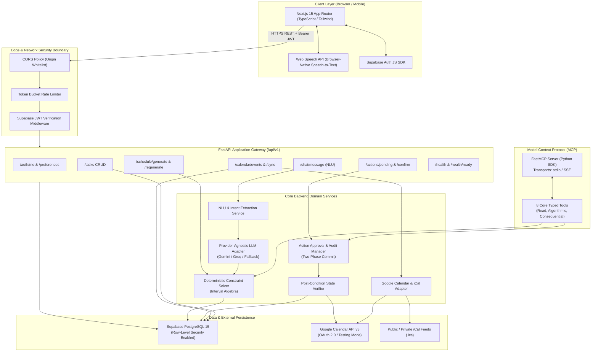

# System Architecture — Mentor AI

**Version:** 1.0.0-ARCH  
**Status:** Approved for Implementation  
**Monorepo Pattern:** Decoupled Modular Monorepo (`apps/web` + `apps/api`)  

---

## 1. System Architecture Diagram



---

## 2. Component Breakdown & Responsibilities

### 2.1 Next.js 15 App Router (`apps/web`)
- **Technology:** Next.js 15, React 19, TypeScript, Tailwind CSS, Radix UI primitives, Lucide Icons.
- **Responsibilities:**
  - Renders responsive dashboard, interactive daily schedule timeline, task management board, chat interface, and pending action modals.
  - Client-side token storage via Supabase Auth session helpers with automatic token refresh.
  - Passes user Bearer tokens in headers (`Authorization: Bearer <token>`) on all API requests.
  - Implements optimistic UI updates for task completions and drag-and-drop time block adjustments.

### 2.2 Web Speech API (Client-Side Audio Transcription)
- **Technology:** Browser-native `window.webkitSpeechRecognition` / `window.SpeechRecognition`.
- **Responsibilities:**
  - Provides zero-cost voice input directly in modern browsers (Chrome, Edge, Safari).
  - Transcribes spoken instructions to text on the client without sending audio blobs to paid external APIs.
  - Populates the natural language text box before submission, allowing the user to review or edit before sending.

### 2.3 Security & API Gateway Layer (`apps/api/app/core`)
- **Technology:** FastAPI middleware, Starlette CORS, Pydantic v2 settings.
- **Responsibilities:**
  - **CORS Whitelist:** Rejects unauthorized origins; strictly accepts frontend origins (e.g. `http://localhost:3000` or production domain).
  - **JWT Verification:** Validates incoming Supabase JWT cryptographic signatures, extracts user identity (`sub`), and injects a typed `AuthenticatedUser` dependency.
  - **Zero Trust on User ID:** Discards any client-supplied `user_id` query parameters or body fields; all queries use the verified authenticated identity.
  - **Rate Limiting:** Protects endpoints against burst abuse using an in-memory token bucket algorithm.

### 2.4 Natural Language Understanding (NLU) & Intent Parser
- **Technology:** Pydantic v2 structured schemas, prompt templates.
- **Responsibilities:**
  - Transforms user prompts into structured `DraftPlan` objects: detects target date, identifies new fixed events, extracts tasks with durations, detects deadlines, and extracts user constraints.
  - **Clarification Detection:** Identifies missing mandatory parameters (e.g., duration for a task) and generates a structured clarification response rather than guessing.

### 2.5 Provider-Independent AI Model Adapter (`apps/api/app/services/ai`)
- **Technology:** Python `google-genai` / `litellm` / `httpx`.
- **Responsibilities:**
  - Standardized interface `BaseLLMAdapter` with concrete implementations:
    1. **GeminiAdapter:** Utilizes Google Gemini 1.5/2.5 Flash via Google AI Studio free tier (15 RPM, 1M TPM).
    2. **GroqAdapter:** Fast inference fallback (Llama 3.3 70B, free tier).
    3. **DeterministicOfflineAdapter:** Pure regex and rule-based parser that requires zero API keys and 0 internet access, ensuring CI/CD and offline testing work with 100% determinism.
  - Enforces automatic retries with exponential backoff on HTTP 429 (Rate Limit) and HTTP 503 errors.

### 2.6 Deterministic Constraint-Satisfaction Scheduler (`apps/api/app/services/scheduler`)
- **Technology:** Pure Python, `datetime`, `zoneinfo`. Zero heavy solver dependencies like Z3 or PuLP needed; optimized interval algebra algorithm.
- **Responsibilities:**
  - Treats fixed calendar events as immutable barriers.
  - Computes contiguous available time intervals within user working hours.
  - Inserts mandatory buffer intervals (e.g. 15 minutes) adjacent to fixed events.
  - Sorts pending tasks by priority (`P1` > `P2` > `P3` > `P4`), deadline urgency, and duration.
  - Places tasks into available intervals using best-fit heuristics.
  - Detects and flags oversubscription or impossible deadlines with structured conflict reports.

### 2.7 Action Approval & Two-Phase Execution Manager (`apps/api/app/services/actions`)
- **Technology:** SQLAlchemy 2.0, PostgreSQL JSONB storage.
- **Responsibilities:**
  - Stages consequential mutations in the `action_history` table with status `pending_approval`.
  - Generates unique `idempotency_key` to prevent duplicate execution on network retries.
  - Executes mutation only after the user posts confirmation (`confirmed: true`).
  - Calls the `VerificationService` post-execution.

### 2.8 State Verification Service (`apps/api/app/services/actions/verification.py`)
- **Responsibilities:**
  - Queries target state to verify mutation outcome:
    - For task operations: verifies database row status and properties.
    - For calendar operations: queries Google Calendar API to ensure the event ID exists with matching start/end times.
  - Records verification proof in `action_history.verification_result`.
  - Never marks an action as completed without verifiable evidence.

### 2.9 Model Context Protocol (MCP) Server (`apps/api/app/mcp`)
- **Technology:** Official Python Model Context Protocol SDK (`mcp` / `fastmcp`).
- **Responsibilities:**
  - Exposes 8 core typed tools with standard JSON schemas.
  - Supports `stdio` transport (for local CLI / IDE agents) and `sse` transport (for remote agent integration).
  - Authenticates tool calls and proxies requests to domain services.

### 2.10 Supabase PostgreSQL & Row-Level Security
- **Technology:** PostgreSQL 15, Supabase Auth.
- **Responsibilities:**
  - Stores all persistent entities (`profiles`, `user_preferences`, `tasks`, `calendar_events`, `schedules`, `schedule_blocks`, `action_history`, `audit_logs`).
  - Row-Level Security (RLS) policies enforce database-level isolation: `USING (auth.uid() = user_id)`.

---

## 3. Data Flow Workflows

### 3.1 Standard Scheduling Flow
```
User Prompt -> Web Speech / Text Box -> POST /api/v1/chat/message 
  -> JWT Validated -> NLU Parser -> Gemini Flash (or Offline Fallback) 
  -> Extracted DraftPlan -> Fetch Fixed Events & Preferences from DB 
  -> Deterministic Solver -> Conflict-Free Schedule Blocks 
  -> Staged in DB -> Returned to Frontend -> Rendered on Timeline
```

### 3.2 Two-Phase External Mutation Flow
```
User Request ("Add meeting to Google Calendar") -> NLU Identifies External Mutation
  -> Action Staged in DB (Status: pending_approval, Idempotency Key generated)
  -> Frontend Shows Approval Banner with Exact Diff
  -> User Clicks [Approve] -> POST /api/v1/actions/{id}/confirm
  -> Google Calendar API Invoked -> State Verification Queries Calendar
  -> Verification Confirmed -> DB Status: completed -> Frontend Notification
```

---

## 4. Trust Zones & Security Boundaries

| Zone | Assets / Boundaries | Protections |
| :--- | :--- | :--- |
| **Zone 1: Public Untrusted** | Browser Client, Voice Audio, Unauthenticated Requests | HTTPS, CORS, Rate Limiting, Input Sanitization |
| **Zone 2: Authenticated Boundary** | REST API `/api/v1`, MCP SSE Transport | Supabase JWT verification, Pydantic v2 Schema Validation |
| **Zone 3: Core Application** | Python Domain Services, Scheduler, LLM Adapter | Non-executable prompts, least privilege API scopes |
| **Zone 4: Persistent Storage** | PostgreSQL Database | Row-Level Security, Encrypted at Rest, Service Role Key Isolation |
| **Zone 5: Third-Party APIs** | Google Calendar API, Google AI Studio | OAuth 2.0 with minimal scopes, Server-Side Secret Storage |
