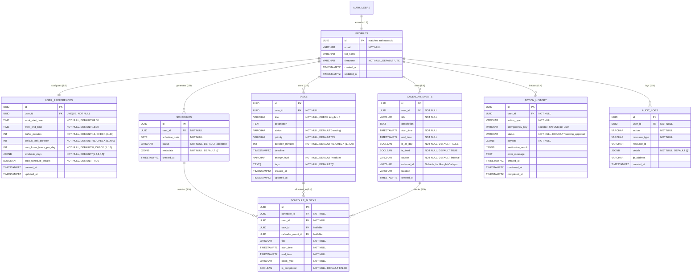

# Database Design & Migrations Plan — Mentor AI

**Database Engine:** PostgreSQL 15+ (Hosted on Supabase Free Tier or Local Docker)  
**ORM & Migrations:** SQLAlchemy 2.0 (Asyncpg) + Alembic  
**Data Isolation:** Native PostgreSQL Row-Level Security (RLS)  

---

## 1. Entity-Relationship (ER) Diagram



---

## 2. Table Specifications, Constraints & Indexes

### 2.1 Profiles (`public.profiles`)
- **Primary Key:** `id UUID` references `auth.users(id)` with `ON DELETE CASCADE`.
- **Ownership:** Linked 1-to-1 with Supabase Auth identities.
- **Constraints:** `email NOT NULL`.
- **Indexes:** Primary key index on `id`.

### 2.2 User Preferences (`public.user_preferences`)
- **Primary Key:** `id UUID DEFAULT uuid_generate_v4()`.
- **Foreign Key:** `user_id UUID UNIQUE REFERENCES public.profiles(id) ON DELETE CASCADE`.
- **Check Constraints:**
  - `CHECK (buffer_minutes >= 0 AND buffer_minutes <= 60)`
  - `CHECK (default_task_duration > 0 AND default_task_duration <= 480)`
  - `CHECK (max_focus_hours_per_day > 0 AND max_focus_hours_per_day <= 16)`
- **Indexes:** Unique index on `user_id`.

### 2.3 Tasks (`public.tasks`)
- **Primary Key:** `id UUID DEFAULT uuid_generate_v4()`.
- **Foreign Key:** `user_id UUID REFERENCES public.profiles(id) ON DELETE CASCADE`.
- **Check Constraints:**
  - `CHECK (char_length(TRIM(title)) > 0)`
  - `CHECK (status IN ('pending', 'in_progress', 'completed', 'cancelled'))`
  - `CHECK (priority IN ('P1', 'P2', 'P3', 'P4'))`
  - `CHECK (duration_minutes > 0 AND duration_minutes <= 720)` (Max duration: 12 hours)
  - `CHECK (energy_level IN ('high', 'medium', 'low'))`
- **Indexes:**
  - Composite Index: `idx_tasks_user_status (user_id, status)` — for fast retrieval of open tasks.
  - Range Index: `idx_tasks_deadline (user_id, deadline)` — for sorting tasks nearing deadline.

### 2.4 Calendar Events (`public.calendar_events`)
- **Primary Key:** `id UUID DEFAULT uuid_generate_v4()`.
- **Foreign Key:** `user_id UUID REFERENCES public.profiles(id) ON DELETE CASCADE`.
- **Check Constraints:**
  - `CHECK (end_time > start_time)` — Prevents inverted or zero-length intervals.
  - `CHECK (source IN ('internal', 'google_calendar', 'ical'))`
- **Indexes:**
  - Range Index: `idx_cal_events_time (user_id, start_time, end_time)` — for interval collision queries.
  - Partial Unique Index: `idx_cal_events_external_id (user_id, source, external_id) WHERE external_id IS NOT NULL` — prevents duplicate imports.

### 2.5 Schedules & Schedule Blocks (`public.schedules`, `public.schedule_blocks`)
- **Primary Key:** `id UUID DEFAULT uuid_generate_v4()`.
- **Foreign Keys:**
  - `schedules.user_id REFERENCES public.profiles(id) ON DELETE CASCADE`
  - `schedule_blocks.schedule_id REFERENCES public.schedules(id) ON DELETE CASCADE`
  - `schedule_blocks.user_id REFERENCES public.profiles(id) ON DELETE CASCADE`
  - `schedule_blocks.task_id REFERENCES public.tasks(id) ON DELETE SET NULL`
  - `schedule_blocks.calendar_event_id REFERENCES public.calendar_events(id) ON DELETE SET NULL`
- **Check Constraints:**
  - `CHECK (schedule_blocks.end_time > schedule_blocks.start_time)`
  - `CHECK (schedule_blocks.block_type IN ('task', 'fixed_event', 'break', 'buffer'))`
- **Indexes:**
  - Index: `idx_schedules_user_date (user_id, schedule_date)`
  - Index: `idx_blocks_schedule (schedule_id)`

### 2.6 Action History & Audit Logs (`public.action_history`, `public.audit_logs`)
- **Primary Key:** `id UUID DEFAULT uuid_generate_v4()`.
- **Check Constraints:**
  - `CHECK (status IN ('pending_approval', 'executing', 'completed', 'failed', 'rejected'))`
- **Indexes:**
  - Partial Unique Index: `idx_actions_idempotency (user_id, idempotency_key) WHERE idempotency_key IS NOT NULL` — ensures idempotent retries.
  - Index: `idx_audit_logs_user_time (user_id, created_at)`

---

## 3. Row-Level Security (RLS) Policy Architecture

PostgreSQL Row-Level Security is strictly enabled on every user-facing table. Even in the event of an application SQL vulnerability, the database engine drops any row not belonging to the authenticated JWT identity:

```sql
-- Pattern applied to ALL tables:
ALTER TABLE public.<table_name> ENABLE ROW LEVEL SECURITY;

CREATE POLICY "<table_name>_tenant_isolation"
    ON public.<table_name> FOR ALL
    USING (auth.uid() = user_id)
    WITH CHECK (auth.uid() = user_id);
```

For `public.profiles`, the policy evaluates `auth.uid() = id`.

---

## 4. Migrations & Alembic Strategy

Migrations are managed through Alembic in `apps/api/alembic/` using asynchronous SQLAlchemy 2.0:
- **Baseline Migration (`001_initial_schema.py`):** Creates all tables, foreign keys, check constraints, indexes, and triggers.
- **RLS Migration (`002_enable_rls.py`):** Enables RLS on all tables and creates declarative tenant isolation policies.
- **Execution Workflow:**
  ```bash
  # Run pending migrations
  alembic upgrade head
  
  # Generate new migration when models change
  alembic revision --autogenerate -m "describe_change"
  ```
- **Local Fallback:** Alembic migrations are written to support both Supabase PostgreSQL and local PostgreSQL/SQLite runners for isolated offline unit testing.

---

## 5. Data Privacy, Export & Account Deletion

- **GDPR / Privacy Compliance:** 
  - `DELETE /api/v1/auth/me` triggers a cascading delete across `public.profiles`, automatically wiping all user preferences, tasks, calendar events, schedules, blocks, and action logs via `ON DELETE CASCADE`.
  - `GET /api/v1/auth/export` produces a consolidated JSON dump of all user tasks, events, and schedules.
