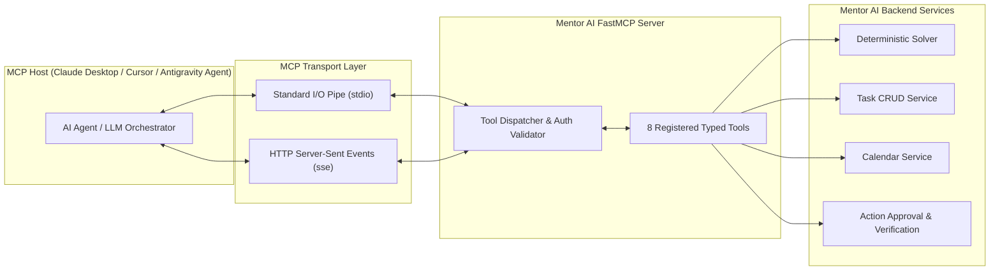

# Model Context Protocol (MCP) Specification — Mentor AI

**Protocol Version:** MCP v2024-11-05+  
**SDK:** Official Python MCP SDK (`mcp` / `fastmcp`)  
**Transports Supported:** `stdio` (local agent CLI/IDE) and `sse` (HTTP Server-Sent Events)  

---

## 1. Architectural Distinction: MCP vs. Alexa vs. MCP-Compatible App

> ⚠️ **Critical Clarification:** Model Context Protocol (MCP), Native Alexa/Alexa+ Integration, and MCP-Compatible Applications are **fundamentally different technologies** and must not be conflated.

| Technology | Architecture & Protocol | Transport | Primary Purpose | Mentor AI Implementation |
| :--- | :--- | :--- | :--- | :--- |
| **Model Context Protocol (MCP) Server** | Open JSON-RPC standard for tool-calling between LLM hosts and local/remote tools. | `stdio` pipes or HTTP `sse` | Allows AI agents (Claude Desktop, Cursor, Antigravity) to safely discover and execute tools. | **Fully Implemented:** Official Python FastMCP server exposing 8 typed tools. |
| **Native Alexa / Alexa+ Skill** | Amazon-proprietary Voice Skill API requiring Alexa Skills Kit (ASK), AWS Lambda endpoints, and Amazon Developer Console OAuth linking. | Amazon Cloud HTTPS Directive Dispatch | Invocation via Amazon Echo smart speakers using voice directives (*"Alexa, ask Mentor..."*). | **Not an MCP Server:** If required, connects as a lightweight webhook client calling `/api/v1/chat/message`. Browser voice uses Web Speech API. |
| **MCP-Compatible Application** | A client application that can discover, connect to, and invoke tools on external MCP servers. | Client JSON-RPC over `stdio`/`sse` | Consuming third-party tools within an agent loop. | **Supported:** Mentor AI can act as both tool provider (server) and consumer. |

---

## 2. FastMCP Server Architecture



---

## 3. The 8 Core MCP Tool Specifications

### Tool 1: `get_user_context`
- **Category:** Read-Only (Safe)
- **Description:** Retrieves the authenticated user's profile, working hours, active timezone, default buffer, and pending urgent tasks.
- **Input Schema:**
```json
{
  "type": "object",
  "properties": {}
}
```
- **Output:** JSON object containing `timezone`, `work_start_time`, `work_end_time`, `buffer_minutes`, and `pending_tasks_count`.

---

### Tool 2: `list_tasks`
- **Category:** Read-Only (Safe)
- **Description:** Queries tasks with status, priority, and deadline window filters.
- **Input Schema:**
```json
{
  "type": "object",
  "properties": {
    "status": {"type": "string", "enum": ["pending", "in_progress", "completed", "cancelled"]},
    "priority": {"type": "string", "enum": ["P1", "P2", "P3", "P4"]},
    "limit": {"type": "integer", "default": 20, "maximum": 50}
  }
}
```

---

### Tool 3: `create_task`
- **Category:** Internal Mutation (Safe)
- **Description:** Adds a new validated task draft to the user's task repository.
- **Input Schema:**
```json
{
  "type": "object",
  "properties": {
    "title": {"type": "string", "minLength": 1, "maxLength": 200},
    "duration_minutes": {"type": "integer", "minimum": 1, "maximum": 720},
    "priority": {"type": "string", "enum": ["P1", "P2", "P3", "P4"], "default": "P3"},
    "deadline": {"type": "string", "format": "date-time"},
    "description": {"type": "string"}
  },
  "required": ["title", "duration_minutes"]
}
```

---

### Tool 4: `update_task`
- **Category:** Internal Mutation (Safe)
- **Description:** Updates properties or completion status of an existing task.
- **Input Schema:**
```json
{
  "type": "object",
  "properties": {
    "task_id": {"type": "string", "format": "uuid"},
    "status": {"type": "string", "enum": ["pending", "in_progress", "completed", "cancelled"]},
    "duration_minutes": {"type": "integer", "minimum": 1, "maximum": 720},
    "priority": {"type": "string", "enum": ["P1", "P2", "P3", "P4"]}
  },
  "required": ["task_id"]
}
```

---

### Tool 5: `get_calendar_events`
- **Category:** Read-Only (Safe)
- **Description:** Fetches immutable fixed commitments (classes, meetings) within a specific date range.
- **Input Schema:**
```json
{
  "type": "object",
  "properties": {
    "start_time": {"type": "string", "format": "date-time"},
    "end_time": {"type": "string", "format": "date-time"}
  },
  "required": ["start_time", "end_time"]
}
```

---

### Tool 6: `create_calendar_event`
- **Category:** Consequential Mutation (Requires User Confirmation)
- **Description:** Stages an external or internal fixed calendar event. Staged in `action_history` with status `pending_approval`.
- **Input Schema:**
```json
{
  "type": "object",
  "properties": {
    "title": {"type": "string"},
    "start_time": {"type": "string", "format": "date-time"},
    "end_time": {"type": "string", "format": "date-time"},
    "location": {"type": "string"}
  },
  "required": ["title", "start_time", "end_time"]
}
```
- **Output:** Returns `{ "status": "staged_pending_approval", "action_id": "<uuid>" }`.

---

### Tool 7: `generate_schedule`
- **Category:** Algorithmic (Safe)
- **Description:** Calls the deterministic constraint-satisfaction scheduling engine for a specific date.
- **Input Schema:**
```json
{
  "type": "object",
  "properties": {
    "target_date": {"type": "string", "format": "date"},
    "task_ids": {"type": "array", "items": {"type": "string", "format": "uuid"}}
  },
  "required": ["target_date"]
}
```

---

### Tool 8: `verify_action`
- **Category:** State Verification (Safe)
- **Description:** Checks post-condition state for an executed action to guarantee truthfulness.
- **Input Schema:**
```json
{
  "type": "object",
  "properties": {
    "action_id": {"type": "string", "format": "uuid"}
  },
  "required": ["action_id"]
}
```
- **Output:** Returns `{ "verified": true, "details": { ... } }` or `{ "verified": false, "reason": "..." }`.

---

## 4. MCP Security & Transport Sandboxing

1. **Authentication:** Over `sse` transport, requests require `Authorization: Bearer <JWT>` in headers. Over `stdio`, identity is bound to the local authenticated profile.
2. **Zero Shell / SQL Execution:** MCP tools map 1:1 to strict Python service functions. No generic command execution or raw SQL query tools are exposed.
3. **Idempotency Keys:** Every tool execution accepts an optional `idempotency_key` header to ensure safe retries without duplicate records.
