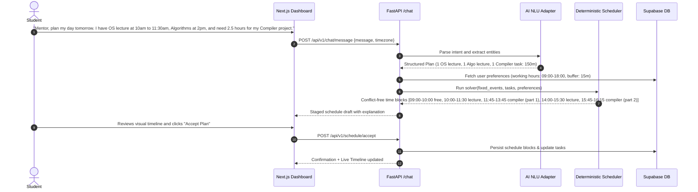
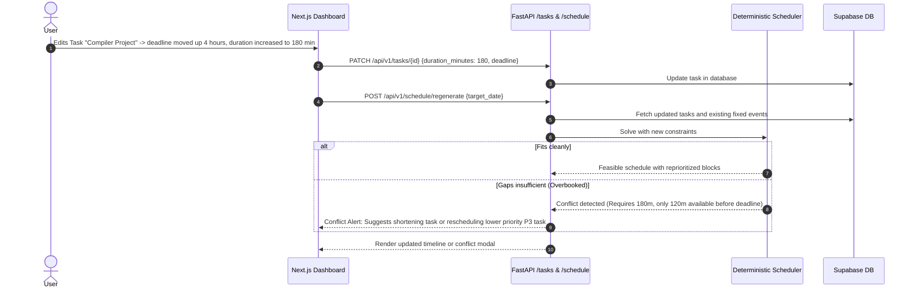

# Product Requirements Document (PRD) — Mentor AI

**Product Name:** Mentor AI  
**Tagline:** *Your Goals. Your Plan. Your Next Move.*  
**Target Delivery Window:** 12 Days | **Budget:** $0.00 USD (Strict Zero-Budget)  
**Status:** Approved for Day 1 Architectural Baseline  

---

## 1. Executive Summary & Vision

University students and working professionals constantly juggle asynchronous deadlines, fixed commitments (lectures, labs, team standups), and fragmented blocks of discretionary time. Existing calendar apps are passive viewers, while existing AI chatbots hallucinate time intervals, overlap meetings, and fabricate promises without verification.

**Mentor AI** is an intelligent, reliable personal scheduling and task-orchestration system. It bridges the gap between natural language intention and mathematical execution by enforcing a strict separation of concerns:
- **Natural Language & AI Orchestration:** Understands messy text/voice thoughts, asks clarification questions when information is incomplete, and extracts structured task drafts.
- **Deterministic Scheduling Engine:** Executes interval algebra in pure application code to generate conflict-free, realistic time-blocked schedules that respect hard commitments, user availability, priorities, and buffer times.
- **Model Context Protocol (MCP) & Action Verification:** Exposes standardized tools and executes external mutations only after explicit human approval, verifying every outcome against real data before reporting success.

---

## 2. Target Personas

### Persona A: The Computer Science / STEM Student
- **Profile:** Alex, a 3rd-year undergraduate taking 4 rigorous courses, juggling lab submissions, exam study, and team project deadlines.
- **Pain Points:** 
  - Class times change across odd/even weeks.
  - Assignments require deep focus blocks (2–3 hours) but get scheduled during fragmented 30-minute breaks.
  - Procrastination and underestimating task duration cause panic right before deadlines.
- **Needs:** Input raw prompts like *"Plan my day tomorrow: 2 lectures, 1 lab, and I need 3 hours for Operating Systems homework"*, with automatic placement into contiguous focus blocks.

### Persona B: The Working Professional / Technical Lead
- **Profile:** Priya, an engineering lead balancing back-to-back client/team meetings with code reviews and technical architecture writing.
- **Pain Points:**
  - Calendar is controlled by external attendees.
  - Ad-hoc urgent tasks disrupt planned work.
  - Context switching fatigue from zero buffer between meetings.
- **Needs:** Intelligent slotting of P1/P2 tasks into real open gaps, automatic buffer insertion (15–20 mins), and reliable calendar sync.

---

## 3. Core User Journeys

### User Journey 1: Student Planning Study Sessions & Assignments

### User Journey 2: Working Professional Organizing Meetings & Tasks
1. Professional opens Mentor AI dashboard.
2. The system retrieves existing fixed calendar meetings via the integration service.
3. User adds 3 high-priority tasks: "PR Review" (45m, P1), "Draft Q4 Roadmap" (90m, P2), "Inbox Zero" (30m, P3).
4. User clicks **"Generate Schedule"**.
5. Deterministic scheduler sorts tasks by priority, checks working hours (08:30–17:30), preserves 15-minute buffers after meetings, and places high-priority deep work in morning slots.
6. The schedule timeline renders showing fixed meetings in blue, focus blocks in purple, and buffers in soft grey.

### User Journey 3: Changing a Deadline or Availability After Schedule is Generated

### User Journey 4: Reviewing and Approving an External Action (Two-Phase Commit)
1. User asks: *"Mentor, schedule a project sync on my Google Calendar for Friday at 3pm."*
2. NLU extracts target: Event title: "Project Sync", Time: Friday 15:00–16:00, Action: `create_calendar_event` on external provider.
3. System classifies this action as **Consequential** (external calendar modification).
4. The backend stages the action in `action_history` with status `pending_approval` and generates an `idempotency_key`.
5. The UI displays an **Action Approval Banner**:
   - *Action:* Create Google Calendar Event
   - *Title:* Project Sync
   - *Time:* Oct 16, 2026, 3:00 PM – 4:00 PM
   - *Controls:* [Approve & Sync] | [Reject]
6. User clicks **[Approve & Sync]**.
7. Backend executes the Google Calendar API call with the idempotency key.
8. Backend runs **State Verification**: queries Google Calendar API to ensure event ID exists and matches payload.
9. Backend updates `action_history` status to `completed`, stores `verification_result`, and updates UI.
10. If the external API fails (e.g., token expired), the backend records `failed`, details the exact error, and prompts for re-authentication. It **never** claims success falsely.

---

## 4. Functional Requirements (FR)

| ID | Requirement | Description |
| :--- | :--- | :--- |
| **FR-01** | User Authentication & Isolation | Secure signup/login via Supabase Auth (JWT). Strict multi-tenant data isolation via PostgreSQL Row-Level Security (RLS). User ID extracted only from verified token. |
| **FR-02** | User Profile & Preferences | Configurable working hours (`work_start_time`, `work_end_time`), buffer duration (0–60m), max daily focus hours, available days, and timezone. |
| **FR-03** | Task Lifecycle Management | Full CRUD operations for tasks: title, description, priority (`P1`–`P4`), estimated duration (minutes), deadline, energy level, and status (`pending`, `in_progress`, `completed`, `cancelled`). |
| **FR-04** | Fixed Calendar Events | Manage fixed commitments (classes, meetings) with immutable start/end times that cannot be overwritten by scheduled tasks. |
| **FR-05** | Natural Language Parsing | Parse natural language instructions (text and Web Speech API audio transcripts) into validated structured JSON (`DraftPlan`). |
| **FR-06** | Missing Information Clarification | If an instruction is missing critical fields (e.g., duration or deadline), prompt the user for clarification rather than hallucinating values. |
| **FR-07** | Deterministic Scheduling Engine | Pure algorithmic interval solver that places tasks in valid gaps between fixed events and buffers without overlap, respecting priority and deadlines. |
| **FR-08** | Conflict Detection & Reporting | Detect oversubscription and impossible deadlines; report precise conflicts with actionable options (shorten, reschedule, drop). |
| **FR-09** | Two-Phase Consequential Action Approval | Consequential external mutations require user review and explicit confirmation before execution. |
| **FR-10** | Action Verification & Audit Trail | Verify post-condition state after every mutation. Persist immutable history in `action_history` and `audit_logs`. |
| **FR-11** | Model Context Protocol (MCP) Server | Implement an MCP server exposing 8 typed tools (`get_user_context`, `list_tasks`, `create_task`, `update_task`, `get_calendar_events`, `create_calendar_event`, `generate_schedule`, `verify_action`). |
| **FR-12** | Offline / Deterministic Fallback Mode | Provide an offline rule-based parser that executes task creation and scheduling with 0 external API calls and $0 cost. |

---

## 5. Non-Functional Requirements (NFR)

- **NFR-01 (Zero Budget):** Built strictly within \$0.00 USD infrastructure (Supabase, Vercel, Render/local container, Gemini free tier). No paid licenses or required credit cards.
- **NFR-02 (Performance):** 
  - Deterministic scheduling algorithm runtime $\le 100\text{ms}$ for up to 100 items/day.
  - Backend API response time (excluding external LLM calls) $\le 200\text{ms}$.
- **NFR-03 (Security):** 
  - Zero API keys or secrets exposed to client-side code.
  - Strict input sanitization via Pydantic v2.
  - All database tables protected by RLS.
  - Protection against prompt injection, IDOR, and CORS spoofing.
- **NFR-04 (Truthfulness & Integrity):** No mocked action results reported as real; clear error reporting for failed external calls.
- **NFR-05 (Accessibility & UX):** Responsive design across mobile and desktop. Keyboard navigation and WCAG 2.1 AA compliant color contrast.
- **NFR-06 (Maintainability):** Modular monorepo with strict TypeScript and Python types, automated test suite, and database migrations.

---

## 6. Explicit Exclusions (Out of Scope)

1. ❌ **What-If Simulations:** No speculative future-branching or simulation engines.
2. ❌ **Personal Recommendation Features:** No unsolicited wellness, lifestyle, or motivational advice.
3. ❌ **Fake Integrations:** No non-functional mock UI elements masquerading as real services.
4. ❌ **Unnecessary Microservices:** Monorepo architecture with a single FastAPI backend; no Redis or Kubernetes.

---

## 7. Risk Register & Feature Prioritization

### Must-Have vs. Optional Feature Matrix

| Feature | Priority | Rationale |
| :--- | :--- | :--- |
| **Supabase Auth + RLS Data Isolation** | **Must-Have (P0)** | Foundation for secure multi-tenancy and data safety. |
| **Task Management CRUD & Validation** | **Must-Have (P0)** | Core data model for the application. |
| **Deterministic Interval Scheduling Solver** | **Must-Have (P0)** | Primary algorithmic differentiator; eliminates LLM hallucinations. |
| **Conflict & Overlap Detection** | **Must-Have (P0)** | Essential for trustworthy planning. |
| **Natural Language Parser (Gemini + Offline Fallback)** | **Must-Have (P0)** | Primary user input channel. |
| **Two-Phase Action Approval Workflow** | **Must-Have (P0)** | Critical safety mechanism for external mutations. |
| **State Verification & Audit History** | **Must-Have (P0)** | Truthfulness requirement; prevents false-positive reports. |
| **MCP Server with 8 Core Tools** | **Must-Have (P1)** | Interoperability standard for agentic tool use. |
| **Next.js Dashboard & Schedule Timeline** | **Must-Have (P1)** | Primary visual UI for students and professionals. |
| **Google Calendar OAuth Sync** | **Must-Have (P1)** | Real external calendar integration. |
| **Universal iCal (.ics) Feed Sync** | **Should-Have (P2)** | Zero-config, universal calendar subscription backup. |
| **Web Speech API Voice Input** | **Should-Have (P2)** | Client-side, browser-native voice transcription (0 cost). |
| **Automated Task Break Injection** | **Nice-to-Have (P3)** | Ergonomic addition to scheduling engine. |

### Risk Register

| Risk ID | Description | Severity | Likelihood | Mitigation Strategy |
| :--- | :--- | :--- | :--- | :--- |
| **R-01** | LLM API rate limits on free tier (e.g. Gemini 15 RPM). | High | High | Implement automatic retry with exponential backoff, user-visible rate-limit notices, and automatic fallback to offline rule-based parser. |
| **R-02** | Supabase free tier database pause after 7 days inactivity. | Medium | Medium | Automated keep-alive script in local/CI environment; standard Alembic migrations enable zero-downtime recreation or SQLite fallback. |
| **R-03** | Cloud hosting cold start delays (Render free tier ~50s). | Medium | High | Health check keep-alive probe; transparent UI loading indicator explaining cold-start wake-up. |
| **R-04** | Prompt injection attempting to forge task execution or read other users' data. | High | Low | LLM outputs are constrained strictly to JSON schema; execution passes through backend authorization; RLS prevents cross-tenant access. |
| **R-05** | Google OAuth verification requirement for production apps. | Low | High | Use Google Cloud "Testing" mode allowing up to 100 authorized test users with zero verification fees. Provide iCal as zero-auth alternative. |
