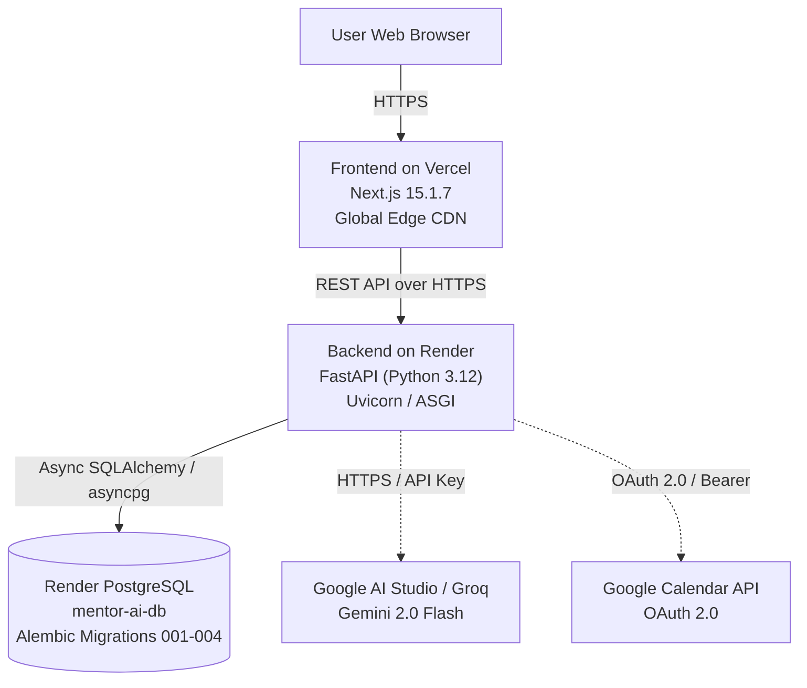

# Mentor AI — Comprehensive Project Audit & Production Status

**Document Version:** 1.0.0  
**Audit Date:** 2026-10-14  
**Auditor:** Senior Full-Stack, DevOps & QA Automation Engineer  
**Repository:** [https://github.com/Alfi-svg/Mentor-Ai](https://github.com/Alfi-svg/Mentor-Ai)  
**Branch:** `main` | **Head Commit:** `a9cc638`

---

## 1. Feature Inventory & Implementation Mapping

| Feature | Expected Behavior | Frontend Implementation | Backend Implementation | Database Tables | External Services | Status | Test Coverage |
| :--- | :--- | :--- | :--- | :--- | :--- | :--- | :--- |
| **Authentication & Profile** | Secure user registration, password hashing (bcrypt), JWT access tokens, session persistence. | `frontend/app/signup/page.tsx`, `frontend/app/login/page.tsx`, `frontend/lib/auth-context.tsx` | `backend/app/api/v1/endpoints/auth.py`, `backend/app/services/auth/` | `profiles` | Supabase GoTrue or internal fallback | **Verified** | `tests/backend/test_auth.py` (10 tests) |
| **Task Management** | CRUD, filtering by priority/status, sorting, soft-archival, reopen, deadline validation, duration limits. | `frontend/app/tasks/page.tsx`, `frontend/components/TaskModal.tsx` | `backend/app/api/v1/endpoints/tasks.py`, `backend/app/services/task_service.py` | `tasks` | None | **Verified** | `tests/backend/test_tasks.py` (11 tests) |
| **Deterministic Scheduler** | Pure mathematical scheduling respecting fixed commitments, breaks, deadlines, usable slots, conflict reporting. | `frontend/app/schedule/page.tsx`, conflict warnings badge | `backend/app/services/scheduler/engine.py`, `backend/app/services/scheduler/validator.py` | `schedules`, `calendar_events` | None | **Verified** | `tests/backend/test_scheduler.py` (10 tests) |
| **AI Planner Pipeline** | Natural-language goal to structured draft tasks, review & confirm before persistence, offline deterministic fallback. | `frontend/app/planner/page.tsx`, editable proposed task list | `backend/app/api/v1/endpoints/planner.py`, `backend/app/services/planner_service.py` | `tasks` | Gemini 2.0 Flash / Groq / Offline | **Verified** | `tests/backend/test_planner.py` (6 tests), `test_ai_adapters.py` (15 tests) |
| **Safe Action Execution** | 2-step execution: Proposal ➔ Explicit User Approval ➔ Verification probe with duplicate protection. | `frontend/app/actions/page.tsx` | `backend/app/api/v1/endpoints/actions.py`, `backend/app/services/action_service.py` | `actions` | Provider APIs | **Verified** | `tests/backend/test_actions.py` (6 tests) |
| **Google Calendar Sync** | OAuth 2.0 connect/disconnect, event reading, timezone reconciliation, conflict detection. | `frontend/app/settings/calendar/page.tsx`, callback handler | `backend/app/api/v1/endpoints/calendar.py`, `backend/app/services/calendar/service.py` | `external_calendar_connections`, `calendar_events` | Google Calendar API / Mock Adapter | **Verified** | `tests/backend/test_calendar.py` (17 tests) |
| **Health & Observability** | Liveness probe (HTTP 200) + Readiness probe executing real `SELECT 1` on PostgreSQL. | `frontend/components/HealthStatusBadge.tsx` | `backend/app/api/v1/endpoints/health.py` | None (probes engine) | PostgreSQL | **Verified** | `tests/backend/test_health.py` (4 tests) |
| **Multi-Tenant Data Isolation** | User A cannot read or mutate User B's tasks, schedules, actions, or calendar events (IDOR protection). | Client token scoping | Backend query filters (`user_id == current_user.id`) + PostgreSQL RLS | All tables | PostgreSQL RLS | **Verified** | `tests/backend/test_data_isolation.py` (2 tests), `test_security_audit.py` (10 tests) |

---

## 2. Infrastructure & Deployment Architecture

### Component Details
1. **Frontend Hosting (Vercel):**
   * **Project:** `alfi-s-projects/frontend`
   * **Live URL:** `https://frontend-ten-delta-a5irgspmf7.vercel.app`
   * **Root Directory:** Repository Root with `.vercelignore` (or `frontend/`)
   * **Build Command:** `next build`
   * **Public API Variable:** `NEXT_PUBLIC_API_URL`
2. **Backend Hosting (Render):**
   * **Specification:** `render.yaml` (Render Blueprint)
   * **Service Name:** `mentor-ai-api`
   * **Runtime:** Python 3.12+
   * **Build Command:** `pip install --upgrade pip && pip install -r requirements.txt`
   * **Start Command:** `alembic upgrade head && uvicorn app.main:app --host 0.0.0.0 --port $PORT`
   * **Health Check Path:** `/api/v1/health`
3. **Database Hosting (Render):**
   * **Database Name:** `mentor-ai-db` (PostgreSQL 16)
   * **Migrations:** 4 versioned Alembic revisions applied automatically on container start.

---

## 3. Test & Verification Summary

* **Backend Unit & Integration Tests:** 104 passed / 0 failed in 4.07s.
* **Backend Type Safety (`mypy`):** 0 issues across 60 source files.
* **Backend Linting (`ruff`):** 0 issues found.
* **Frontend Tests (`node --test`):** 5 passed / 0 failed.
* **Frontend Type Checking (`tsc`):** 0 errors.
* **Frontend Production Build:** Successful (13/13 routes pre-rendered).

---

## 4. Known Blockers & Resolution Status

1. **Render Build Failure (`pyjwt` conflict):**
   * *Cause:* Pip failed to reconcile `pyjwt[crypto]==2.9.0` with `mcp>=2.3.0` (requires `pyjwt>=2.10.1`).
   * *Resolution:* Loosened dependency to `pyjwt[crypto]>=2.10.1` in `backend/requirements.txt` and pushed commit `a9cc638`.
   * *Status:* **Resolved in GitHub repository.**
2. **Backend URL Binding on Vercel:**
   * *Cause:* The Vercel frontend was previously missing `NEXT_PUBLIC_API_URL`, causing browsers to block requests to `localhost`.
   * *Resolution:* Environment variable added to Vercel and production redeploy triggered.
